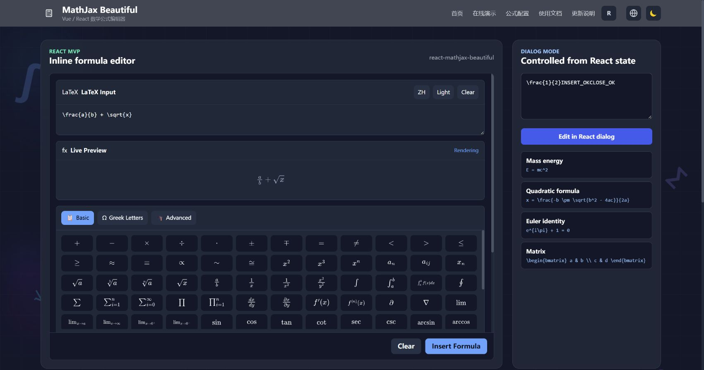

# Editor insertion browser checks

Run from the repository root:

```sh
pnpm exec vite --config tests/browser/vite.config.ts
```

Open <http://127.0.0.1:3107/>. This fixture loads the actual Vue editor and local MathJax, without mocks.

1. Place the caret between `LEFT ` and `RIGHT` and choose `fixture.png` using the image toolbar button. The image should load at that position; type immediately afterwards.
2. Open the formula dialog, enter `\frac{1}{2}`, and insert it. Type immediately afterwards. The image and surrounding text should remain intact, with the caret outside the SVG.
3. Open and cancel the dialog, then type. Text should appear at the original caret.
4. Click the existing formula, replace it with `x+1`, and insert. There should still be only one formula, in its original position.
5. Insert another image after that formula and continue typing. Both images should remain visible, and the synchronized content should retain their `blob:` sources.

Automated DOM regressions live in `tests/editor-insertion.test.ts` and `tests/sanitize.test.ts`. Real browser checks are manual because jsdom does not implement native editing commands or file pickers.

## Verification evidence

Manually verified in Chromium on 2026-10-16 using the real editor and local MathJax: image insertion and loading, continued typing after images and formulas, caret restoration after cancelling the formula dialog, and replacement of an existing formula. The final recheck confirmed the image loaded at its natural width of 96 pixels, the formula SVG remained noneditable, the caret stayed inside the editor and outside the SVG, and no browser console errors occurred.

The screenshot shows `FORMULA_OK` typed after the formula and `IMAGE_OK` typed after the uploaded image, between the original `LEFT` and `RIGHT` text. Other browser engines have not been checked.


## Demo routes and React dialog focus (2026-10-19)

Automated regressions: `pnpm exec vitest run tests/demo-static-routes.test.ts tests/react-dialog-focus.test.ts`.
The route test runs a real Vite build and checks the generated HTML entry points and GitHub Pages asset base. The React tests mount the real component and cover cancel, submit, close, controlled close, selected text, contenteditable ranges, unmount/StrictMode, removed targets, caller-selected focus, inline mode, and the demo trigger.

Verified in real Chrome against the production build with `VITE_BASE_URL=/mathjax-beautiful/`, served at `http://127.0.0.1:3113/mathjax-beautiful/` by a strict directory/index static server with **no SPA fallback**:

- The home page and all seven subroutes return HTTP 200; an unknown route still returns 404.
- Direct navigation to `/demo` and browser reload work in both Vue and React modes. Existing clean URLs are preserved; the static host redirects directories to their trailing-slash form.
- In React mode, put the caret after `LEFT ` in the right-hand input, open the dialog with the mouse, cancel, and type without clicking again: the result is `LEFT CANCEL_OKRIGHT`.
- Submit `\frac{1}{2}` and immediately type `INSERT_OK`; close another dialog with its X button and type `CLOSE_OK`. Both append at the restored caret, without clicking the input again.
- Tab from the input to the trigger and press Enter; cancelling restores keyboard focus to the trigger. Body scrolling is restored, and the browser reports no application console errors.

This verifies this branch's local production artifact, not a live deployment or a newly published npm version. Firefox and Safari have not been checked.



