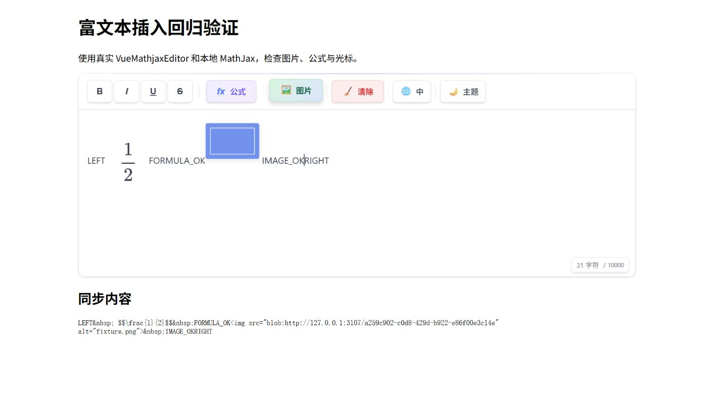

# Editor insertion browser checks

Run from the repository root:

```sh
pnpm exec vite --config tests/browser/vite.config.ts
```

Open <http://127.0.0.1:3107/>. This fixture loads the actual Vue editor and local MathJax, without mocks.

1. Place the caret between `LEFT ` and `RIGHT` and choose `fixture.png` using the image toolbar button. The image should load at that position; type immediately afterwards.
2. Open the formula dialog, enter `\frac{1}{2}`, and insert it. Type immediately afterwards. The image and surrounding text should remain intact, with the caret outside the SVG.
3. Open and cancel the dialog, then type. Text should appear at the original caret.
4. Click the existing formula, replace it with `x+1`, and insert. There should still be only one formula, in its original position.
5. Insert another image after that formula and continue typing. Both images should remain visible, and the synchronized content should retain their `blob:` sources.

Automated DOM regressions live in `tests/editor-insertion.test.ts` and `tests/sanitize.test.ts`. Real browser checks are manual because jsdom does not implement native editing commands or file pickers.

## Verification evidence

Manually verified in Chromium on 2026-10-16 using the real editor and local MathJax: image insertion and loading, continued typing after images and formulas, caret restoration after cancelling the formula dialog, and replacement of an existing formula. The final recheck confirmed the image loaded at its natural width of 96 pixels, the formula SVG remained noneditable, the caret stayed inside the editor and outside the SVG, and no browser console errors occurred.

The screenshot shows `FORMULA_OK` typed after the formula and `IMAGE_OK` typed after the uploaded image, between the original `LEFT` and `RIGHT` text. Other browser engines have not been checked.


